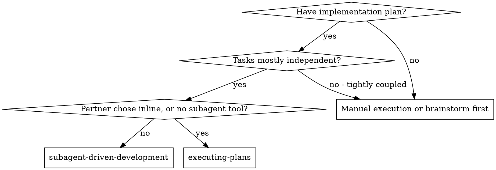
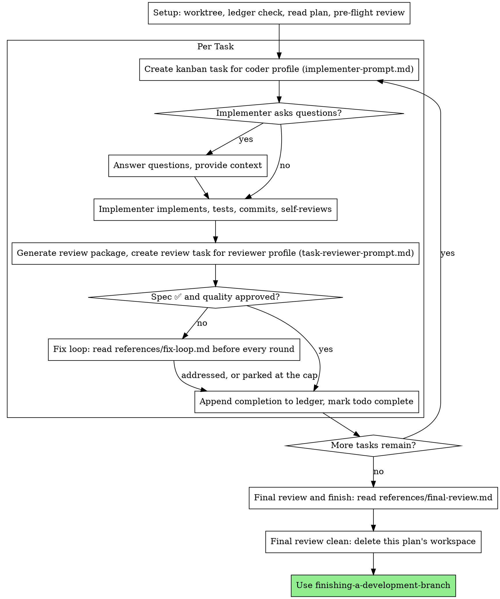

# Subagent-Driven Development

Execute plan by creating a fresh implementer task per step — in the multi-profile setup a Kanban task assigned to the coder profile, which works it in its own session (fresh context) — a task review (spec compliance + code quality) after each, and a broad whole-branch review at the end. In-session subagents (delegate_task) are the fallback for solo sessions; the mechanics are the same.

**Why fresh tasks:** You delegate every task to a specialized profile session with an isolated context. By precisely crafting the task body and context, you ensure the executor stays focused and succeeds. It never inherits your session's context or history — you construct exactly what it needs. This also preserves your own context for coordination work.

**Core principle:** Fresh task/profile session per task + task review (spec + quality) + broad final review = high quality, fast iteration

**Narration:** between tool calls, narrate at most one short line — the
ledger and the tool results carry the record.

**Continuous execution:** Do not pause to check in with your human partner between tasks. Execute all tasks from the plan without stopping. The only reasons to stop are the four named below, or all tasks complete. "Should I continue?" prompts and progress summaries waste their time — they asked you to execute the plan, so execute it.

**Rulings, not stalls.** A running plan does not wait on a human. Conflicts,
ambiguities, plan defects, a cap you would have asked to exceed — decide
them. The spec is the binding authority, the plan is its argument, and your
judgment settles what neither answers. Record every decision in the ledger as
`Ruling: <what you decided> — <why> — <what it costs if wrong>`, and keep
going. A wrong ruling costs rework your human partner can see and undo; a
session parked on a question costs their whole day and buys nothing.

Five things stop you, and only these: an irreversible or destructive
operation; a security-sensitive action; a side effect outside this worktree
that norms say you ask about first (a merge, a push to a shared branch, a
publish); a plan so broken that every path forward is a guess; and a ruling
that would overturn an owner decision the project already records (a spec, an
`AGENTS.md`/`STATE.md` line, a code comment marked as the owner's decision).
That last one is not a ruling at all — it is the owner's to make. Asking costs
one message; dispatching a contrary ruling costs a stopped worker, a reverted
tree and an owner who has to re-read the mechanic from scratch. For those five,
stop and ask.

## When to Use

**vs. Executing Plans (inline):**
- Fresh subagent per task (no context pollution) instead of one context doing every task
- Review after each task (spec compliance + code quality) instead of only at the end
- Costs a fresh context per task and per review; inline costs one context plus one final reviewer
- Both run in this session, share the same plan workspace and ledger, and never pause between tasks

## Kanban Dispatch (This Setup)

In the multi-profile setup the "subagents" are **profile sessions**, not
in-session spawns: the Orchestrator puts tasks on the project's Kanban board
(board slug per `.hermes/orchestration.yml`, explicit `board=` on every call),
and each named profile (coder, reviewer) works its tasks in its own session —
which is exactly the "fresh context per task" this skill exists for.

All script paths below are relative to this skill's directory (skill_view →
skill_dir): the terminal starts in the project directory, so `scripts/...` alone
will not resolve.

Per task:

1. `bash <skill_dir>/scripts/task-brief PLAN_FILE N` → brief file (the single source of
   requirements; exact values live only there).
2. Create the kanban task: `board=<slug>`, assignee = the executor profile from
   the routing policy, body links the brief path + `implementation-plan.md` +
   spec + the report contract
   (`workflows/<task_id>/implementation-report.md`).
3. The worker session (executing-plans discipline) implements, tests, commits,
   writes the report, moves the board status.
4. `bash <skill_dir>/scripts/review-package PLAN_FILE BASE HEAD` → package file → kanban
   task for the reviewer profile → findings come back as `review.md`.
5. Fix loop (references/fix-loop.md) rides the board: fix tasks and comments.

The ledger stays in `.superpowers/sdd/<plan>/progress.md` (git-ignored) — the
cross-session recovery map; the board tracks who does what, the ledger tracks
what is actually done.

The in-session subagent mechanics below still apply when the Orchestrator
dispatches small work itself via delegate_task (e.g. research tickets) — the
brief/report-file/no-pasted-history rules are exactly the same.

### Running the board (dispatch, stop, re-spec)

- **Dispatch without hanging your shell.** `hermes kanban dispatch` spawns the
  worker as a detached process that inherits stdout, so the call can sit open
  (or return an orphan-recovery warning) even though the worker started fine.
  Always run it redirected and bounded:
  `timeout 90 hermes kanban --board <slug> dispatch --max 1 > <log> 2>&1 < /dev/null`.
  `Spawned: 1` in the log is the confirmation; re-check with `hermes kanban list`.
- **Stop a running worker** (the owner interrupts, or the requirement changes):
  `hermes kanban reclaim <id>` releases the claim and ends the run, then
  `hermes kanban block <id> --kind needs_input "<one line why>"`. The reason is a
  POSITIONAL argument — there is no `--reason` flag.
- **Re-spec an existing card, never recreate it.** Write the new body to a file
  and `hermes kanban edit <id> --title T --body "$(cat body.md)"`, then
  `hermes kanban unblock <id>`. Recreating loses the run history and the
  dependent cards' dependency edges. Re-spec has a window: while the card is
  still gated/`todo`. Once a worker holds the claim it has already read the body — put the finding in `kanban_comment` on that card (durable, and the reviewer
  card can point at it) and add the item to the reviewer's checklist, so a
  missed bit returns as CHANGES_REQUESTED instead of shipping. Read a body back
  with `show <id> --json | python3 -c "…['task']['body']" > f.md`; never call
  bare `show` to check status — it echoes the whole body and comment thread
  back into your context. Status/assignee/model checks are `list --json` piped
  through a filter.
- **A spec change also rewrites the dependent cards.** The reviewer task's body
  encodes the spec it checks against; edit only the implementer's card and the
  reviewer will demand the old design. Edit both, then dispatch.
- **Dirty-tree safety.** Workers run in the live project dir
  (`workspace_kind=dir`), not a throwaway worktree. Record `git status --short`
  at session start (and the fact that those dirty files are the owner's), so a
  re-spec can rip out a half-done worker's edits with
  `git checkout -- <exactly the files that were clean then>` without touching
  the owner's uncommitted work. Read the worker's `git diff` first and confirm it
  holds nothing but that worker's changes.
- **Park, then re-decide, then unblock.** A blocked card keeps its context and
  its comment history; that is why the owner's answer goes back onto the same
  card instead of a fresh one.
- **`triage` is the backlog lane; `promote` will not move it.** `hermes kanban
  promote <id>` accepts only `todo`/`blocked`; a card created with
  `triage: true` — the right initial state for work the owner has not chosen
  yet, since triage cards are never dispatched — is released with
  `hermes kanban specify <id>`, which moves it to todo/ready for the
  dispatcher. Create owner-pending candidates in triage, then specify the one
  the owner picks.
- **Prep the card BEFORE `specify`, not after.** Releasing a triage card hands
  it to the dispatcher within a tick: the body you wrote at triage time is what
  the worker reads, and with no per-task pin it runs on the assignee profile's
  `config.yaml` model — an unapproved model, and the Model Gate violation lands
  as a live run, not as a refused dispatch. So the order is: rewrite the body
  (`--body "$(cat body.md)"`, board flag on the `kanban` command, not the
  subcommand), `set-model`, then `specify`. Caught after the fact, the fix is
  `reclaim` → `set-model` → let the dispatcher retry; check `git status` over
  the worker's paths first, since the aborted run may already have written
  files.
- **Rework after both cards are done: a fresh follow-up task, not a reopen.**
  `unblock` and `reopen-review` refuse cards in `done` — a CHANGES_REQUESTED
  discovered after the review card closed cannot requeue the implementer.
  Open a NEW task parented on the review card, scope narrowed to exactly the
  reviewer's Required Changes (e.g. tests only, game files untouched), body
  carrying them verbatim; leave a comment on the done card for history.
- **With a separate reviewer card, the implementer card must say
  `kanban_complete`, not `kanban_request_review`.** The worker's own lifecycle
  moves its card into the review lane, so the reviewer picks up the implementer
  card — under the implementer's model — while your reviewer card sits gated on
  the same diff: two review seats on one change, and the board shows the
  implementer still running in `review`. Put the instruction in the card body
  ("close with `kanban_complete`; independent review is a separate card").
  When you forget it, the symptom is a notice naming the *implementer* card as
  `@reviewer … done` and its assignee flipping to the reviewer: that is the
  duplicate seat consuming your change, not a second opinion — the reviewer card
  is still gated on the same diff.
- **Review-lane worker crashes at spawn with `kanban_skills_unavailable`.**
  The review lane force-loads `sdlc-review`; if that name sits in the
  assignee profile's `skills.disabled`, every review run dies in ~10 s
  (exit 1, empty output) and the card lands in `blocked` after two retries.
  Check the profile config's `skills.disabled` before blaming the model;
  remove the name, then unblock or (when a separate reviewer card exists)
  complete the implementer card — never recreate it.
- **A crash's cause picks the response; three look identical on the board.**
  `hermes kanban --board <slug> runs <id>` prints outcome, elapsed and the
  worker's last line. `Kanban owner refused: Gateway disconnected; turn outcome
  is unknown` is infrastructure: the dispatcher retries by itself and no model
  change is warranted — but check `git status`/`git diff` over the worker's paths
  before the retry gets far, so half-written edits from the dead run are known
  and a retry is not mistaken for progress. A spawn-fail with rc=0 and no kanban
  call at all is a bad `model_override`; a wall of `APITimeoutError` is the
  provider. Only the latter two justify touching the model map, and only after
  asking.
- **The card body is a tool argument, not a document.** A body pasted straight
  out of your reasoning can pass the transport limit: a multi-kilobyte card
  stalls the call and returns nothing. Keep the body to the contract (objective,
  read/modify lists, bounds, acceptance) and put the long spec — long
  tables, dump excerpts, findings — in a project file (`.scratch/<wave>/…md`)
  that the body names as read-first. Same for edits: assemble the new body in
  pieces in a file, then `--body "$(cat f.md)"`.
  The stall is not specific to card bodies: a long spec file written in a single
  `write_file` call fails the same way. Write it in two or three smaller pieces
  (or create it small and `patch` it), keep the card body to one screen, and let
  the body point at the spec file.
- **Notifications lag the board and contradict it.** A chat notice can report
  "worker crashed", "timed out (max_runtime=0s), will retry", or "retrying"
  for a run that actually finished — the completion notice for the same card
  arrives after. Card status and run history (`kanban_show`) are
  authoritative: check them before re-dispatching, recreating a card, or
  chasing a phantom crash.
- **Reading the tree while a worker holds the claim returns half-built states.**
  A generate/classify module re-imported mid-edit yields empty lists and missing
  keys that read like real defects; a grep started a minute ago sees a partial
  rewrite. Attribute the anomaly to "the worker is editing right now", and re-run
  the check after the card is `done` before you write it up as a finding or build
  a card body from it.
- **Board-less subcommands resolve the board by env.** `comment` (and any
  subcommand without a `--board` flag) fails with "unknown task" on a
  non-default board — prefix `HERMES_KANBAN_BOARD=<slug>`.
- **`--board` belongs to `kanban`, not to the subcommand.**
  `hermes kanban dispatch --board <slug>` dies with `unrecognized arguments`;
  the accepted form is `hermes kanban --board <slug> dispatch …`.
- **A per-item work list hides cross-item inconsistency — accept at class
  level, not per item.** When the card enumerates items (files, endpoints,
  checklist entries) and the shared behaviour is one idiom, checking each item against
  its own spec passes while the same input pattern behaves differently in two
  items: the coder copies the reference only where the list named it, and the
  reviewer verifies item-by-item, so nothing compares them. Two consequences.
  (a) The card's acceptance carries a class line — "every occurrence of this
  primitive in the data behaves identically" — and you verify it yourself by
  enumerating the primitive from the source data and diffing the per-item
  behaviour, not by reading the report. (b) A review that attributes behaviour
  to "the orchestrator's decision" is reporting your own split instruction
  back at you: re-read what you actually told the coder for the sibling items
  before treating the verdict as agreement.
- **A timed-out `clarify` is not an answer.** No response means the owner is
  away, not that they agreed: take the coherent default, write the decision and
  its rollback recipe (which files to revert, which table entries to drop) into
  the wave's journal, and say plainly in the final message what you decided and
  that it is reversible. Never resolve a decision the project already records
  (spec, `AGENTS.md`, a comment marked as the owner's) this way — that class
  waits for a real answer, and asking again is cheaper than a reverted tree.
- **A report's green suite counts only what the worker ran.** Check the
  ticket's acceptance batteries against the report's test list before
  dispatching review: a worker that ran only its new test file and lint can
  hide a 2-failure regression in a named static battery — the reviewer must
  re-run every battery the ticket names, not just the new suite.
- **A wave that changes a codebase-wide convention breaks old test pins.**
  Static probes pin shapes (a required text, a required element, a count);
  when the owner re-specs the convention, sweep test files for pins of the
  old shape BEFORE dispatch and put their update into the ticket — otherwise
  the worker ships a correct code change with a hidden failing battery it
  never ran. When it surfaces in the full run anyway: the code is right, the
  pins are stale, and the fix is a test-only follow-up — update probes to
  the new convention, never weaken or delete them. An extraction helper that
  reads one level of a structure misses nested items — helpers must descend
  to the nesting level the spec names.

## Confirm Models & Providers Before Dispatch (REQUIRED GATE)

Before creating ANY kanban tasks for a plan, confirm the model map with your
human partner. Providers differ in reliability (some — like anymodel — have
temporarily unavailable models or paused subscriptions), and a worker that
discovers a dead provider mid-task burns the budget of the whole run.

1. Build the map: **every executor profile the plan will touch** (coder,
   reviewer, architect — whoever the routing policy assigns tasks to) →
   provider/model, read from each profile's `config.yaml`
   (`model.provider`, `model.default`). The reviewer is part of the map:
   the final whole-branch review is a capable-model job by design.
   When the user names a model in shorthand (e.g. «deepseek-flash»), resolve it
   to the exact model id from `config.yaml`/`custom_providers` (e.g. `deepseek-v4-flash`)
   and state what you set — never write a shorthand that is not a real model id.
   **A provider's id namespace is not the profile's default string.** The same
   model usually has a different id per provider (a bare `glm-5.3-flash` on one,
   a slash-prefixed `glm/glm-5.3` on another), and the profile default is only
   valid for the provider that profile is configured with. When the approved map
   names provider P + model M, list P's own models (`GET <base_url>/models` with
   that provider's key) and copy the id it returns verbatim; an id from the wrong
   namespace fails at worker spawn, after the claim, not at creation.
2. Present it as a table and ask for explicit approval. For unreliable
   providers, propose the fallback: which profile/model takes over.
3. Offer a cheap health-check per executor (a one-token test call through that
   profile) — recommended for flaky providers before a long run. Probe with the
   exact id you are about to pin. Read the result correctly: a 200 with empty
   content is a working model (reasoning models often emit no text at a tiny
   `max_tokens`), while an empty or non-JSON body is a retry, not a verdict —
   probe twice before calling a provider dead, then report it and ask which
   fallback to apply instead of swapping on your own.
4. Record the approved map in the ledger and in the first kanban task's body.
5. NEVER switch a profile's model/provider silently mid-run. If a provider dies
   (worker fails on an unavailable model, the circuit breaker trips):
   `kanban_block` the task, ask your human partner which fallback to use,
   apply it, unblock. A silent model swap is a decision made in secret.
6. **The gate is enforced, not advisory.** Skipping it does not merely break
   policy — a supervisor (the mentor/наставник) auto-blocks the task with
   "Model Gate: модель не утверждена" before the worker runs. There is no
   fast path; the first dispatch is where the block lands.

**"Approval" can mean changing the executor's model — two mechanisms, pick by scope.**
The approved map may disagree with a profile's `config.yaml` (e.g. the profile sits on
`custom:anymodel / am/minimax-m3`, the user wants `zai / glm-5.3-flash`):
- project-specific choice → pin it per task: `hermes kanban set-model [--provider P] <task_id> <model>`
  (the profile's global config stays untouched for its other projects);
- the user approves it as the profile's new default → patch the profile's `config.yaml`
  (`model.provider` / `model.default`) — and say explicitly that this changes every
  project of that profile. A fallback-only change edits the `fallback_providers` list
  (each entry `provider`/`model`) instead of the primary keys — the primary stays put,
  so this is narrower than a default change and affects only failover.

**Recovery when the block already landed:** get explicit approval → apply the model
(per-task `set-model`, or patch the profile config when the user chose that) → record
the approved map in the task body via `kanban_comment` → `kanban_unblock`. Do not
recreate the task: the blocked card carries the context, and the supervisor re-checks
it on unblock.

## The Process

## Setup

Ensure the work happens in an isolated workspace. In the multi-profile setup the
coder session creates the worktree with using-git-worktrees (it is a coding-module
skill); the Orchestrator only verifies it exists (`git worktree list`) before the
first dispatch. In a solo session, create it yourself with using-git-worktrees.
Never start implementation on a main/master branch without your human
partner's explicit consent.

Conversation memory does not survive compaction. In real sessions,
controllers that lost their place have re-dispatched entire completed task
sequences — the single most expensive failure observed. Track progress in
a ledger file, not only in todos.

- Each plan owns a workspace: at skill start, run this skill's
  `bash <skill_dir>/scripts/sdd-workspace PLAN_FILE` — it prints the plan's git-ignored
  directory (under `<repo-root>/.superpowers/sdd/`), home to
  every artifact for THIS plan: ledger, briefs, reports, review packages.
  Another plan's directory is never yours to read or write.
- Check for this plan's ledger at `<workspace>/progress.md`. If one exists,
  read [references/resuming.md](references/resuming.md) before anything
  else: it says whose ledger it is and where to resume.
- Create the ledger with its identity as the first line:
  `# SDD ledger — plan: <plan file path>`.
- The ledger is your recovery map: the commits it names exist in git even
  when your context no longer remembers creating them. After compaction,
  trust the ledger and `git log` over your own recollection.
- `git clean -fdx` will destroy the workspace (it's git-ignored scratch); if
  that happens, recover from `git log`.

Read the plan once, note its context and Global Constraints, and create a
todo per task. If the plan names a Spec, read that too: the spec is the
authority the plan argues from, and conflicts inside the plan resolve
against it. A plan with no reachable spec gets a ledger note saying so —
rulings made without one are provisional.

Before dispatching Task 1, read [references/preflight.md](references/preflight.md)
and run the conflict scan it describes. Its table and rulings go in the
ledger.

## Model Selection

**In this setup** the model belongs to the profile: tiering is done by choosing
the assignee (coder = implementation tier, architect/reviewer = capable tier),
not by per-dispatch arguments — Hermes workers inherit their profile's
`model.provider` / `model.default` (or `delegation.*` pinning). Escalation is a
reassignment: move the stuck task to a stronger profile via the board (or a
rewritten brief), never a silent model swap.

Use the least powerful model that can handle each role to conserve cost and increase speed.

**Mechanical implementation tasks** (isolated functions, clear specs, 1-2 files): use a fast, cheap model. Most implementation tasks are mechanical when the plan is well-specified.

**Integration and judgment tasks** (multi-file coordination, pattern matching, debugging): use a standard model.

**Architecture and design tasks**: route them to the strongest profile approved in
the Model Gate (architect). The final whole-branch review is one of these — it
goes to the reviewer profile, whose model is the one approved in the gate, not
whatever the session happens to default to.

**Review tasks**: choose the model with the same judgment, scaled to the
diff's size, complexity, and risk. A small mechanical diff does not need the
top tier; a subtle concurrency change does. Scoped re-reviews of
small fix diffs take a cheap-to-mid tier.

**Fix-loop escalation (rounds 4-5)**: reassign the task to a profile at least one
tier above the one that got stuck — ask the human partner before changing profiles.

**In this setup the model is fixed per profile.** You cannot and must not pass a
model per dispatch: escalate by reassigning the task to a stronger profile on the
board (approved in the Model Gate). In a solo session without an orchestrator, the
same tiering logic applies to the model of the session you work in — pick it once,
up front, and never swap it silently mid-task.

**Turn count beats token price.** Wall-clock and context cost scale with how
many turns a subagent takes, and the cheapest models routinely take 2-3× the
turns on multi-step work — costing more overall. Use a mid-tier model as the
floor for reviewers and for implementers working from prose descriptions.
When the task's plan text contains the complete code to write, the
implementation is transcription plus testing: use the cheapest tier for
that implementer. Single-file mechanical fixes also take the cheapest tier.

**Task complexity signals (implementation tasks):**
- Touches 1-2 files with a complete spec → cheap model
- Touches multiple files with integration concerns → standard model
- Requires design judgment or broad codebase understanding → strongest profile (architect)

## The Task Loop

**Small same-shape work:** when the plan lists several small edits of the
same kind across files, read [references/batching.md](references/batching.md)
before dispatching them.

Everything you paste into a dispatch prompt — and everything a subagent
prints back — stays resident in your context for the rest of the session
and is re-read on every later turn. Hand artifacts over as files.

**Waiting on dispatched subagents:** never poll a wait interface with
short timeouts, and never sit in one silent, open-ended wait either.
While you have local work — ledger updates, packaging the next review,
reading reports — keep working; child results arrive on their own.
When you are genuinely idle, wait in bounded stretches (five to ten
minutes, where your platform allows), and between stretches post one
line of status and reconcile your live children: list them, and chase
any that finished without reporting. A bounded stretch keeps nearly
all of a long wait's efficiency while guaranteeing a stuck or lost
child is noticed within minutes, not at the end of the session.

### 1. Dispatch the implementer (a kanban task in the multi-profile setup)

Record BASE (`git rev-parse HEAD`) before dispatching — the review package
and fix-round diffs need it.

- **Task brief:** before dispatching an implementer, run this skill's
  `bash <skill_dir>/scripts/task-brief PLAN_FILE N` — it extracts the task's full text to a
  uniquely named file and prints the path. Compose the dispatch so the
  brief stays the single source of
  requirements. Your dispatch should contain: (1) one line on where this
  task fits in the project; (2) the brief path, introduced as "read this
  first — it is your requirements, with the exact values to use verbatim";
  (3) interfaces and decisions from earlier tasks that the brief cannot
  know; (4) your resolution of any ambiguity you noticed in the brief;
  (5) the report-file path and report contract. Exact values (numbers,
  magic strings, signatures, test cases) appear only in the brief. Never
  make an executor read the whole plan file.
- **Report file:** in kanban mode the report goes where the orchestration
  hand-off contract says — `workflows/<task_id>/implementation-report.md`; in a
  solo in-session run name it after the brief (`…/task-N-brief.md` →
  `…/task-N-report.md`). Put the full path in the dispatch. The implementer
  writes the full report there and returns only status, commits, a one-line
  test summary, and concerns.
- A dispatch prompt describes one task, not the session's history. Do not
  paste accumulated prior-task summaries ("state after Tasks 1-3") into
  later dispatches — a real session's dispatch hit 42k chars of which 99%
  was pasted history. A fresh subagent needs its task, the interfaces it
  touches, and the global constraints. Nothing else.
- The dispatch carries the no-subagents contract (it is in the
  implementer template): the implementer never dispatches subagents —
  not helpers, and never a reviewer. Review arrives from you, after the
  report. In real sessions, every reviewer a worker spawned duplicated
  the task review the controller dispatched anyway — a full extra
  review seat per task.
- If an earlier task parked a finding in the area this task touches, carry
  a pointer to that ledger entry in the dispatch.
- In-session mode only: record the implementer's agent identity from the
  dispatch result (fix-loop rounds 1-3 resume this agent). Kanban mode has no
  live agent across profile sessions — every round is a new task and the report
  file is the memory.
- Never dispatch multiple implementation subagents in parallel (conflicts).

Template: [implementer-prompt.md](implementer-prompt.md)

### 2. Handle the report

Implementer subagents report one of four statuses. Handle each appropriately:

**DONE:** Generate the review package (`bash <skill_dir>/scripts/review-package PLAN_FILE BASE HEAD`, from this skill's directory — it prints the unique file path it wrote; BASE is the commit you recorded before dispatching the implementer — never `HEAD~1`, which silently drops all but the last commit of a multi-commit task), then dispatch the task reviewer with the printed path.

**Any other status** (DONE_WITH_CONCERNS, NEEDS_CONTEXT, BLOCKED): read
[references/handling-reports.md](references/handling-reports.md) and follow
it, every time you get one.

If the implementer asks questions — before starting or mid-task — answer
clearly and completely, provide additional context if needed, and don't
rush it into implementation.

### 3. Review the task

Per-task reviews are task-scoped gates. The broad review happens once, at the
final whole-branch review. Never skip the task review, and never accept a
report missing either verdict — spec compliance AND task quality are both
required. Implementer self-review never replaces the task review; both are
needed.

- Hand the reviewer its diff as a file: run this skill's
  `bash <skill_dir>/scripts/review-package PLAN_FILE BASE HEAD` and pass the reviewer the file path
  it prints (or, without bash: `git log --oneline`, `git diff --stat`,
  and `git diff -U10` for the range, redirected to one uniquely named
  file). The output never enters your own context, and the reviewer sees
  the commit list, stat summary, and full diff with context in one Read
  call. Use the BASE you recorded before dispatching the implementer —
  never `HEAD~1`, which silently truncates multi-commit tasks. Never
  dispatch a task reviewer without a diff file.
- **Reviewer inputs:** the task reviewer gets three paths — the same brief
  file, the report file, and the review package — plus the global
  constraints that bind the task.
- The global-constraints block you hand the reviewer is its attention
  lens. Copy the binding requirements verbatim from the plan's Global
  Constraints section or the spec: exact values, exact formats, and the
  stated relationships between components ("same layout as X", "matches
  Y"). The reviewer's template already carries the process rules (YAGNI,
  test hygiene, review method) — the constraints block is for what THIS
  project's spec demands.
- Do not add open-ended directives like "check all uses" or "run race tests
  if useful" without a concrete, task-specific reason
- Do not ask a reviewer to re-run tests the implementer already ran on the
  same code — the implementer's report carries the test evidence
- Do not pre-judge findings for the reviewer — never instruct a reviewer to
  ignore or not flag a specific issue. If you believe a finding would be a
  false positive, let the reviewer raise it and adjudicate it in the review
  loop. If the prompt you are writing contains "do not flag," "don't treat X
  as a defect," "at most Minor," or "the plan chose" — stop: you are
  pre-judging, usually to spare yourself a review loop.
If the reviewer reports "⚠️ Cannot verify from diff" items, read
[references/cannot-verify.md](references/cannot-verify.md) before you mark
the task complete.

Template: [task-reviewer-prompt.md](task-reviewer-prompt.md)

### 4. The fix loop

The loop triggers when the review reports spec ❌, any Critical or Important
finding, or a ⚠️ item you confirmed as a real gap.

When it triggers, read [references/fix-loop.md](references/fix-loop.md) and
follow it. Read it again before every round, even if you read it earlier in
this session: it holds the round cap, the breaker, and the ledger line each
round writes, and your memory of it does not survive compaction.

### 5. Complete the task

When the review comes back clean — or every open finding is parked with a
ruling at the cap — append the completion line to the ledger in the same
message as your other bookkeeping:

- `Task <N>: complete (commits <base7>..<head7>, review clean)`
- `Task <N>: complete (commits <base7>..<head7>, <K> parked)` after a
  tripped breaker

Then mark the todo complete and move on. Never move to the next task while
the review has open Critical/Important issues that are neither fixed nor
parked-with-ruling at the cap.

## Final Review

When every task is complete, read
[references/final-review.md](references/final-review.md) and follow it. It
covers the whole-branch review, its single fix wave, and how you finish.

## Common Rationalizations

| Excuse | Reality |
|--------|---------|
| "Close enough on spec compliance" | Reviewer found spec gaps = not done. Fix or hit the cap and adjudicate — those are the only exits. |
| "I'll fix it myself, dispatching is overhead" | Controller fixes pollute your context and skip review. Resume the implementer. |
| "One more round will converge" | Past the cap, rounds don't converge — the failure is structural. Adjudicate and route. |
| "The reviewer will just find something new anyway" | Scoped re-reviews verify fixes; they cannot wander. New findings on untouched code go to the ledger, not the loop. |
| "This finding is obviously wrong, I'll drop it" | You adjudicate only at the cap, and every ruling is a ledger entry. Silent discards are forbidden. |
| "The fix was small, skip the re-review" | Unreviewed fixes are how regressions land. Every round ends with a scoped re-review. |
| "The mechanic is obvious, I'll rule on it and dispatch" | A ruling that contradicts a decision the project already records (spec, `AGENTS.md`, a comment marked as the owner's) is not a ruling. The owner stops the worker mid-run, the tree has to be reverted, and the mechanic gets re-explained from zero. Establish the rule from the source data and put it in front of them first. |
| "Reviews slow the loop down" | The loop without reviews is just unverified churn. Reviews are the loop's brakes and steering. |
| "Ledger bookkeeping is overhead" | The ledger is what survives compaction. Controllers without one have re-dispatched entire completed task sequences. |
| "The implementer spawned its own reviewer — free extra assurance" | It's a duplicate seat reviewing the same diff; the task review is the gate. A worker-spawned reviewer is a defect to flag, not rigor. |
| "The worker's summary says 'Reviewed and approved' — it self-reviewed" | That is the implementer's SELF-review, not the task review. Dispatch the separate reviewer task anyway. Self-review re-validates the implementer's own assumptions and can bless the exact structure that is wrong (a config never compiled, a schema it invented); only an independent read against the current external docs catches it. |
